# Arbiter (`arbiter-rs`)

[](https://github.com/SamuelMarks/arbiter-rs)
[-orange.svg)](https://www.rust-lang.org/)
[](#verification--quality-gates)
[](#verification--quality-gates)

**Arbiter** (<https://github.com/SamuelMarks/arbiter-rs>) is an [Apache Mesos](https://mesos.apache.org/)-inspired ([original NSDI '11 paper PDF](https://people.eecs.berkeley.edu/~alig/papers/mesos.pdf)), cross-platform, [hardware-topology](https://www.open-mpi.org/projects/hwloc/)-aware resource allocator, multi-cluster federation orchestrator, and shared [consensus](https://raft.github.io/)/[STONITH fencing](https://clusterlabs.org/pacemaker/doc/2.1/Pacemaker_Explained/html/fencing.html) fabric ("Consensus-as-a-Service" / `CaaS`) written in [Rust](https://www.rust-lang.org/).

Arbiter schedules, isolates, and coordinates high-availability stateful workloads natively across **[Linux](https://www.kernel.org/), [FreeBSD](https://www.freebsd.org/), [illumos](https://illumos.org/) ([OmniOS](https://omnios.org/)), [Windows](https://learn.microsoft.com/en-us/windows-server/), and [macOS](https://developer.apple.com/macos/)**, with first-class support for **heterogeneous [CPUs](https://en.wikipedia.org/wiki/Central_processing_unit) ([hybrid P/E cores](https://www.intel.com/content/www/us/en/gaming/resources/how-hybrid-design-works.html), [NUMA](https://www.kernel.org/doc/html/latest/vm/numa.html)), Multi-Vendor [GPUs](https://en.wikipedia.org/wiki/Graphics_processing_unit) ([NVIDIA](https://www.nvidia.com/en-us/data-center/) [MIG](https://www.nvidia.com/en-us/technologies/multi-instance-gpu/)/[MPS](https://docs.nvidia.com/deploy/mps/index.html)/[NVLink](https://www.nvidia.com/en-us/data-center/nvlink/), [AMD ROCm](https://rocm.docs.amd.com/)/[Infinity Fabric](https://www.amd.com/en/technologies/infinity-fabric), [Apple Silicon](https://developer.apple.com/documentation/apple-silicon) [Metal](https://developer.apple.com/metal/)/[ANE](https://machinelearning.apple.com/research/neural-engine-transformers), [Intel XPU](https://www.intel.com/content/www/us/en/developer/tools/oneapi/overview.html)/[Level Zero](https://spec.oneapi.io/level-zero/latest/index.html) tiles), [Google Cloud & Edge TPUs](https://cloud.google.com/tpu/docs/system-architecture-tpu-vm) (2D/3D [ICI torus](https://dl.acm.org/doi/pdf/10.1145/3579371.3589350) pods), and [RDMA](https://www.rdmaconsortium.org/) interconnects ([InfiniBand](https://www.infinibandta.org/), [RoCEv2](https://enterprise-support.nvidia.com/s/article/roce-v2-considerations), [AWS EFA](https://aws.amazon.com/hpc/efa/), [illumos Crossbow VNICs](https://illumos.org/man/8/dladm), [FreeBSD VNETs](https://docs.freebsd.org/en/books/handbook/jails/#jail-vnet))**.

### Companion Documentation

- **[`ARCHITECTURE.md`](./ARCHITECTURE.md)**: Deep-dive into the hybrid 2-level/direct scheduler, 3-tier synchronous/out-of-band/watchdog STONITH fencing hierarchy, generic replicated service state machines, and L2–L7 wire framing mechanics.
- **[`BENCHMARKS.md`](./BENCHMARKS.md)**: Methodology and empirical results for Multiclustering vs. No Multiclustering (`SingleMonolithicCluster` & `SiloedIndependentClusters`) and 3, 5, 7, and $N$-node `PostgreSQL` + `etcd` vs. `arbiter-rs` failover and L2–L7 network traffic benchmarks.
- **[`SECURITY.md`](./SECURITY.md)**: Zero-trust SPIFFE/SPIRE mTLS identity, RBAC/ABAC policy engine, AEAD secret envelopes, split-brain linearizability proofs, and compile-time memory/arithmetic safety gates.
- **[`TODO_PLAN.md`](./TODO_PLAN.md)**: Completed engineering and verification roadmap.

---

## System Architecture Diagram

```mermaid
flowchart TB
    %% Styling Definitions
    classDef client fill:#1e293b,stroke:#38bdf8,stroke-width:2px,color:#f8fafc
    classDef net fill:#0f172a,stroke:#818cf8,stroke-width:2px,color:#e0e7ff
    classDef master fill:#1e1b4b,stroke:#a855f7,stroke-width:2px,color:#f3e8ff
    classDef store fill:#31102f,stroke:#f472b6,stroke-width:2px,color:#fce7f3
    classDef agent fill:#064e3b,stroke:#34d399,stroke-width:2px,color:#ecfdf5
    classDef iso fill:#14532d,stroke:#4ade80,stroke-width:2px,color:#f0fdf4
    classDef hw fill:#451a03,stroke:#fbbf24,stroke-width:2px,color:#fef3c7
    classDef fed fill:#3b0764,stroke:#c084fc,stroke-width:2px,stroke-dasharray: 5 5,color:#f3e8ff

    %% 1. External Clients, Frameworks & Operators
    subgraph Clients["Clients, 2-Level Frameworks & Observability (`arbiter-sdk`, `arbiter-cli`, `arbiter-tui`)"]
        direction LR
        SDK["2-Level Mesos Framework<br/>(`FrameworkScheduler` / `FrameworkRunner`)"]:::client
        Direct["Direct, Gang & Benchmark CLI<br/>(`ArbiterClient` / `arbiter cli bench-*`)"]:::client
        TUI["Terminal UI & Web Dashboard<br/>(`TuiStateModel` / `/dashboard/benchmarks`)"]:::client
        OTel["Prometheus & L2-L7 Wire Accountant<br/>(`/metrics`, `NetworkTrafficAccountant`)"]:::client
    end

    %% 2. Wire Transport & Zero-Trust Security
    subgraph Wire["Dual-Protocol Wire Transport & Zero-Trust Security (`arbiter-proto`, `arbiter-net`)"]
        direction LR
        QUIC["Multiplexed QUIC Binary Framing<br/>(`rkyv` Zero-Copy: Control | Telemetry | P2P)"]:::net
        HTTP["Mesos v1-Compatible HTTP/REST + SSE<br/>(`serde_json`: `/api/v1/{scheduler,executor,operator,jobs}`)"]:::net
        Sec["SPIFFE / SPIRE mTLS & SVID Rotation<br/>RBAC / ABAC Policy + AEAD Secret Envelopes"]:::net
    end

    %% 3. Master Control Plane
    subgraph ControlPlane["Master Control Plane (`arbiter-master`, `arbiter-alloc`, `arbiter-store`)"]
        direction TB

        subgraph AllocEngine["Hybrid Allocation & Scheduling Engine (`arbiter-alloc`)"]
            direction LR
            HDRF["Hierarchical DRF (`HdrfRanker`)<br/>Fixed-Point `SharePartsPerBillion`<br/>Zero `f32`/`f64` Drift"]:::master
            Packer["Topology-Aware Bin-Packer<br/>NUMA | NVSwitch/NVLink Islands<br/>MIG Slicing (`1g.5gb`..`7g.80gb`) & MPS"]:::master
            Gang["Multi-Host Gang & TPU Torus Scheduler<br/>Deadlock-Free Global Agent Ordering<br/>3D `(x, y, z)` Wrap-Around ICI Validation"]:::master
            Preempt["Idle Quota Borrowing & Preemption<br/>Minimal-Disruption Victim Eviction<br/>(`CheckpointAndSuspend` / `Kill`)"]:::master
        end

        subgraph StateConsensus["State Store & Shared Consensus-as-a-Service (`arbiter-store`)"]
            direction LR
            Raft["Embedded Raft Log + CRC32 WalEntry<br/>& Pluggable `etcd` / PostgreSQL / Memory Backends"]:::store
            CaaSMaster["CaaS Election & Lease Manager<br/>Monotonic `FencingToken` Issuance<br/>Generic `ReplicatedStatefulWorkloadTrait`"]:::store
            STONITH["3-Tier Deterministic STONITH Engine<br/>Tier 1: In-Band Agent | Tier 2: OOB BMC/Storage/ToR<br/>Tier 3: Local CaaS Watchdog Self-Demotion"]:::store
        end

        FedRouter["Multi-Cluster Co-Location & Global Federation Router<br/>Cross-Cluster Bursting | Regional DR Failover | `<task>.<service>.<role>.<cluster>.<federation>.arbiter.internal`"]:::fed
    end

    %% 4. Agent Node Supervisor
    subgraph AgentPlane["Cross-Platform Agent Node & Executor Plane (`arbiter-agent`, `arbiter-executor`, `arbiter-storage`)"]
        direction TB
        AgentSup["Agent Supervisor (`AgentNode`)<br/>Resource Accounting | Multi-Cluster Slice Enforcement | Heartbeat Multiplexer"]:::agent
        LocalCaaS["Zero-Packet Local CaaS Lease Cache (`AgentCaasLeaseCache`)<br/>Nanosecond Primary Verification via Unix Domain Socket / Windows Named Pipe"]:::agent
        Storage["Artifact & Volume Manager (`arbiter-storage`)<br/>SHA-256 Content-Addressable LRU Cache | ZFS Datasets (`zfs create`/`jail`/`zone`) | APFS `clonefile` | CSI"]:::agent
        ExecSup["Task Executor (`TaskExecutor`)<br/>Process Lifecycle | Bounded Log Ring Buffer | Active TCP/HTTP/Exec Health Probes"]:::agent
    end

    %% 5. Native 5-OS Isolation Pipeline
    subgraph Isolation["Transactional Rollback Isolation Pipeline (`arbiter-iso::IsolatorPipeline`)"]
        direction LR
        IsoLinux["Linux (`LinuxIsolator`)<br/>`cgroups v2` | Namespaces | `seccomp-bpf`<br/>CRIU Checkpoint | OCI (`runc`/`crun`) | Firecracker"]:::iso
        IsoFreeBSD["FreeBSD (`FreeBsdIsolator`)<br/>Jails (`jail_set`) | `cpuset` | `RCTL`/`RACCT`<br/>`zfs jail` | VNET | `bhyve` MicroVM"]:::iso
        IsoIllumos["illumos / OmniOS (`IllumosIsolator`)<br/>Zones (`zonecfg`/`zoneadm`) | `pset_bind`<br/>Crossbow VNIC (`dladm`) | ZFS | `bhyve`"]:::iso
        IsoWindows["Windows (`WindowsIsolator`)<br/>Job Objects (`CreateJobObject`) | `GROUP_AFFINITY`<br/>HNS Port ACL | HCS (`runhcs`) | Hyper-V VM"]:::iso
        IsoMac["macOS / Darwin (`MacOsIsolator`)<br/>`setrlimit` | Mach QoS P/E Core Steering<br/>`sandbox-exec` SBPL | APFS CoW | `Virtualization.framework`"]:::iso
    end

    %% 6. Hardware Topology & Accelerator Probes
    subgraph Hardware["Hardware Topology & Accelerator Discovery Probes (`arbiter-probe`)"]
        direction LR
        ProbeCPU["Heterogeneous CPU & NUMA Probe<br/>Intel P/E, AMD Zen/Zen-c, Apple M-Series, ARM big.LITTLE<br/>SLIT Distance Matrix | L1/L2/L3 Cache | AVX-512 / AMX / NEON / SVE2"]:::hw
        ProbeGPU["Multi-Vendor GPU Probe<br/>NVIDIA NVML (MIG, MPS, NVLink/NVSwitch)<br/>AMD ROCm (`amd_smi`, xGMI) | Apple Metal & ANE | Intel Level Zero"]:::hw
        ProbeTPU["Google Cloud & Edge TPU Probe<br/>TPU v4 / v5e / v5p / v6e (Trillium) / Coral Edge<br/>HBM Capacity | 2D/3D ICI Torus Coordinates & Healthy Links"]:::hw
        ProbeFabric["RDMA & High-Speed Fabric Probe<br/>InfiniBand (`mlx5`) | RoCEv2 | AWS EFA | GPUDirect RDMA<br/>PCIe Root-Complex Affinity | Crossbow VNIC | FreeBSD VNET"]:::hw
    end

    %% Edges & Data Flows
    Clients <==>|"Subscribe / Offers / Submit / Observe"| Wire
    Wire <==>|"Zero-Copy Frames & REST Events"| ControlPlane
    AllocEngine <-->|"State Transitions & CAS"| StateConsensus
    AllocEngine <-->|"Federated Offer Forwarding"| FedRouter
    ControlPlane <==>|"Single Multiplexed QUIC Stream<br/>(Offers, Tasks, Heartbeats, STONITH)"| AgentSup
    CaaSMaster <==>|"Lease Grants & Fencing Tokens"| LocalCaaS
    STONITH ==>|"Tier 1 In-Band / Tier 2 OOB BMC+Storage<br/>Tier 3 Local Watchdog Self-Fence"| Isolation
    AgentSup -->|"Provision Storage"| Storage
    AgentSup -->|"Launch & Supervise"| ExecSup
    ExecSup -->|"Prepare -> Isolate -> Rollback on Error"| Isolation
    ExecSup <-->|"0-Packet Local Lease Read"| LocalCaaS
    Hardware -->|"Live HardwareTopologyGraph<br/>(Nodes: Socket/NUMA/Core/GPU/TPU/NIC)"| AgentSup
```



---

## Key Architectural Highlights

### 1. Hybrid 2-Level Offer + Direct/Gang Scheduling (`arbiter-alloc`)

- **[Hierarchical Dominant Resource Fairness (HDRF)](https://people.eecs.berkeley.edu/~alig/papers/drf.pdf)**: Multi-resource fair sharing across `(`[CPU](https://en.wikipedia.org/wiki/Central_processing_unit)`, `[Memory](https://en.wikipedia.org/wiki/Random-access_memory)`, `[GPU](https://en.wikipedia.org/wiki/Graphics_processing_unit)` Compute, `[VRAM](https://en.wikipedia.org/wiki/Video_RAM)`, `[TPU](https://cloud.google.com/tpu)` Chips, Disk, Network Bandwidth)` using exact 128-bit intermediate [fixed-point integer arithmetic](https://en.wikipedia.org/wiki/Fixed-point_arithmetic) (`SharePartsPerBillion`) — **zero [IEEE 754 floating-point](https://en.wikipedia.org/wiki/IEEE_754) (`f32`/`f64`) drift**.
- **[Apache Mesos](https://mesos.apache.org/) 2-Level Resource Offers ([NSDI '11 PDF](https://people.eecs.berkeley.edu/~alig/papers/mesos.pdf)) & [Omega](https://research.google/pubs/omega-flexible-scalable-schedulers-for-large-compute-clusters/)-Style Direct Scheduling**: Supports external Mesos-style Frameworks (`FrameworkScheduler`) alongside a zero-overhead built-in First-Party Direct & [Gang Scheduler](https://en.wikipedia.org/wiki/Gang_scheduling).
- **[Topology-Aware Bin-Packing](https://www.open-mpi.org/projects/hwloc/)**: Places tasks onto [NUMA](https://www.kernel.org/doc/html/latest/vm/numa.html) domains, [NVIDIA NVSwitch/NVLink](https://www.nvidia.com/en-us/data-center/nvlink/) GPU islands, [PCIe](https://pcisig.com/)-affinitized [RDMA](https://www.rdmaconsortium.org/) NICs ([GPUDirect RDMA](https://docs.nvidia.com/cuda/gpudirect-rdma/index.html)), and automatically slices [NVIDIA Multi-Instance GPU (MIG)](https://www.nvidia.com/en-us/technologies/multi-instance-gpu/) profiles (`1g.5gb`..`7g.80gb`) or fractional [Multi-Process Service (MPS)](https://docs.nvidia.com/deploy/mps/index.html) weights.
- **Multi-Host [Gang Scheduling](https://en.wikipedia.org/wiki/Gang_scheduling) & [TPU Pod](https://cloud.google.com/tpu/docs/system-architecture-tpu-vm) Co-Scheduling**: Atomic all-or-nothing placement across hosts with deterministic global agent ordering for [deadlock prevention](https://en.wikipedia.org/wiki/Deadlock#Prevention) and [3D torus](https://en.wikipedia.org/wiki/Torus_interconnect) `(x, y, z)` contiguity + wrap-around [Inter-Chip Interconnect (ICI)](https://dl.acm.org/doi/pdf/10.1145/3579371.3589350) link validation.
- **Idle Quota Borrowing & Minimum-Disruption [Preemption](https://en.wikipedia.org/wiki/Preemption_(computing))**: Allows `SpotPreemptible`/`Batch` workloads to borrow idle reserved role quotas as [revocable capacity](https://mesos.apache.org/documentation/latest/oversubscription/) and evicts the minimal-weight victim set (`CheckpointAndSuspend` or `Kill`) when high-priority owners reclaim capacity.

### 2. Shared Election, Lease & 3-Tier [STONITH](https://clusterlabs.org/pacemaker/doc/2.1/Pacemaker_Explained/html/fencing.html) Fencing Plane — "Consensus-as-a-Service" (`arbiter-store::election`, `arbiter-store::ha_generic`, `arbiter-agent::caas`)

- **Generic Stateful Workload & Baseline Coordinator Traits**: Evaluates failover and linearizability across pluggable replication engines (`PrimaryStandbyStreamingModel` for [PostgreSQL](https://www.postgresql.org/) `walsender`/`walreceiver`, `KeyValuePrimaryReplicaModel` for [Redis](https://redis.io/)/[Valkey](https://valkey.io/) `PSYNC2`, and `PartitionedLogBrokerModel` for [Apache Kafka](https://kafka.apache.org/) ISR) against multiple coordinators (`EtcdPatroniSidecarBaseline`, `ConsulSessionLockBaseline`, `KubernetesLeaseControllerBaseline`, and `ArbiterUnifiedCaasCoordinator`).
- **Single-Wire Multiplexed Heartbeats & Zero-Packet Local Lease Reads**: Co-located stateful services piggyback liveness and lease renewals onto the single Agent $\leftrightarrow$ Master [QUIC](https://datatracker.ietf.org/doc/html/rfc9000) stream (`MultiplexedAgentHeartbeat`), while local primary leadership checks query the Agent's `AgentCaasLeaseCache` over a local [Unix Domain Socket](https://man7.org/linux/man-pages/man7/unix.7.html) / [Windows Named Pipe](https://learn.microsoft.com/en-us/windows/win32/ipc/named-pipes) with **0 network packets (`0 B` wire overhead)**.
- **3-Tier Deterministic Fencing Hierarchy (`FenceVerificationReceipt`)**: Eliminates the "reachable LAN STONITH" assumption under asymmetric partitions (`iptables DROP`), `SIGSTOP` pauses, or simultaneous Master+Primary node power-offs:
  1. **Tier 1 — Cooperative In-Band Agent Isolator STONITH (`InBandAgentStonith`)**: Synchronous `SIGKILL` / `TerminateJobObject` + `zfs unmount -f` / CSI detach + VNIC/VNET/eBPF drop in 1 RTT when the agent is reachable.
  2. **Tier 2 — Out-of-Band Hardware / Storage / Fabric Fence (`OutOfBandHardwareOrStorageFence`)**: Immediate IPMI/Redfish BMC chassis power-off (`BmcPowerOffReceipt`), shared-storage SCSI-3 Persistent Reservation / NVMe-oF key preemption (`StorageEpochFenceReceipt`), and ToR switch port shutdown (`SwitchFabricPortIsolateReceipt`) when the node is unreachable in-band.
  3. **Tier 3 — Bounded Local CaaS Watchdog Self-Demotion (`LocalCaasWatchdogSelfFence`)**: Monotonic hardware clock (`/dev/watchdog` / `CLOCK_MONOTONIC_RAW`) deadline on the isolated node revokes local UDS primary leases and terminates local primary processes before any remote standby promotion completes.

### 3. Native Isolation Across 5 Operating Systems (`arbiter-iso`)

- **[Linux](https://www.kernel.org/)**: [`cgroups v2`](https://docs.kernel.org/admin-guide/cgroup-v2.html) (`cpu.max`, `cpuset`, `memory.max`, `io.max`, `pids.max`), [namespaces](https://man7.org/linux/man-pages/man7/namespaces.7.html) (`pid`, `net`, `mnt`, `uts`, `ipc`, `user`), [`seccomp-bpf`](https://www.kernel.org/doc/html/latest/userspace-api/seccomp_filter.html), [CRIU](https://criu.org/) live checkpoint/restore, [OCI](https://opencontainers.org/) containers ([`runc`](https://github.com/opencontainers/runc)/[`crun`](https://github.com/containers/crun)), and [Firecracker](https://firecracker-microvm.github.io/) MicroVMs.
- **[FreeBSD](https://www.freebsd.org/)**: [FreeBSD Jails](https://docs.freebsd.org/en/books/handbook/jails/) ([`jail_set`](https://man.freebsd.org/cgi/man.cgi?query=jail_set&sektion=2)/[`jail_remove`](https://man.freebsd.org/cgi/man.cgi?query=jail_remove&sektion=2)), [`cpuset`](https://man.freebsd.org/cgi/man.cgi?query=cpuset&sektion=1) [NUMA](https://man.freebsd.org/cgi/man.cgi?query=numa&sektion=4)/core pinning, [`RCTL`](https://man.freebsd.org/cgi/man.cgi?query=rctl&sektion=8)/[`RACCT`](https://docs.freebsd.org/en/books/handbook/security/#security-resourcelimits) resource limits, [`zfs jail`](https://openzfs.github.io/openzfs-docs/man/master/8/zfs-jail.8.html) dataset delegation, [VNET](https://man.freebsd.org/cgi/man.cgi?query=vnet&sektion=9) network stacks, and [`bhyve`](https://www.freebsd.org/cgi/man.cgi?query=bhyve&sektion=8) MicroVMs.
- **[illumos](https://illumos.org/) ([OmniOS](https://omnios.org/))**: [Solaris/illumos Zones](https://illumos.org/man/7/zones) ([`zonecfg`](https://illumos.org/man/8/zonecfg)/[`zoneadm`](https://illumos.org/man/8/zoneadm)), processor sets ([`pset_bind`](https://illumos.org/man/2/pset_bind)), [resource controls](https://illumos.org/man/7/resource_controls) (`zone.cpu-shares`, `zone.max-physical-memory`), [Crossbow VNICs](https://illumos.org/man/8/dladm), [ZFS](https://openzfs.org/) zone delegation, and [`bhyve`](https://omnios.org/info/bhyve).
- **[Windows](https://learn.microsoft.com/en-us/windows-server/)**: [Windows Job Objects](https://learn.microsoft.com/en-us/windows/win32/procthread/job-objects) ([`CreateJobObject`](https://learn.microsoft.com/en-us/windows/win32/api/jobapi2/nf-jobapi2-createjobobjectw), hard CPU rate caps, memory/I/O/process limits, [`TerminateJobObject`](https://learn.microsoft.com/en-us/windows/win32/api/jobapi2/nf-jobapi2-terminatejobobject)), [`GROUP_AFFINITY`](https://learn.microsoft.com/en-us/windows/win32/api/winnt/ns-winnt-group_affinity) processor groups (>64 logical processors), [Host Compute System (HCS)](https://learn.microsoft.com/en-us/virtualization/windowscontainers/management/architecture) containers ([`runhcs`](https://github.com/microsoft/hcsshim)), and [Hyper-V](https://learn.microsoft.com/en-us/virtualization/hyper-v-on-windows/) MicroVMs.
- **[macOS (Darwin)](https://developer.apple.com/macos/)**: [`setrlimit`](https://developer.apple.com/library/archive/documentation/System/Conceptual/ManPages_iPhoneOS/man2/setrlimit.2.html), [Mach QoS](https://developer.apple.com/documentation/apple-silicon/tuning-your-code-s-performance-for-apple-silicon) P-core vs E-core thread affinity steering, [`sandbox-exec`](https://reverse.put.as/wp-content/uploads/2011/09/Apple-Sandbox-Guide-v1.0.pdf) SBPL profiles, [APFS](https://developer.apple.com/documentation/foundation/file_system/about_apple_file_system) copy-on-write [`clonefile(2)`](https://www.manpagez.com/man/2/clonefile/) sandboxes, and [`Virtualization.framework`](https://developer.apple.com/documentation/virtualization) MicroVMs.

### 4. Multi-Cluster Co-Location, Federation & L2–L7 Wire Accounting (`arbiter-master::bench`, `arbiter-telemetry::wire_accounting`)

- **Co-Located Logical Cluster Slicing & Cross-Cluster Bursting**: Run multiple logical clusters (`LogicalClusterSlice`) on shared physical bare-metal nodes while bursting overflow direct tasks (`burst_task_to_federation`) and atomic multi-host gang jobs (`burst_gang_to_federation`) across healthy regional peers.
- **L2–L7 Framing-Accurate Wire Accounting**: Tracks both L7 payload bytes and full L2–L4 framing (`Ethernet 18B + IPv4 20B + TCP/TLS 1.3/HTTP/2 gRPC` vs. `UDP/QUIC 1-RTT + AEAD`) across steady-state, fault detection/fencing, and standby promotion/replica rebind windows, calibrated within `< 5%` (`500 bps`) of empirical Vagrant NIC captures.

---

## Hardware & Accelerator Matrix

| Dimension | Supported Platforms / Vendors | Probing Mechanism (`arbiter-probe`) | Scheduling & Isolation Capabilities (`arbiter-alloc`, `arbiter-iso`) |
| :--- | :--- | :--- | :--- |
| **[CPUs](https://en.wikipedia.org/wiki/Central_processing_unit) & [NUMA](https://en.wikipedia.org/wiki/Non-uniform_memory_access)** | [x86_64](https://en.wikipedia.org/wiki/X86-64) ([Intel Hybrid P/E](https://www.intel.com/content/www/us/en/gaming/resources/how-hybrid-design-works.html), [AMD Zen 4/5 & Zen-c](https://www.amd.com/en/products/processors/server/epyc.html)), [AArch64](https://en.wikipedia.org/wiki/AArch64) ([Apple M-Series](https://developer.apple.com/documentation/apple-silicon), [ARM Neoverse / big.LITTLE](https://www.arm.com/technologies/big-little)), [RISC-V (`riscv64gc`)](https://riscv.org/) | Linux [`sysfs`](https://www.kernel.org/doc/html/latest/admin-guide/sysfs-rules.html), FreeBSD/macOS [`sysctl`](https://man.freebsd.org/cgi/man.cgi?query=sysctl&sektion=8), illumos [`kstat`](https://illumos.org/man/8/kstat), Windows [`GetLogicalProcessorInformationEx`](https://learn.microsoft.com/en-us/windows/win32/api/sysinfoapi/nf-sysinfoapi-getlogicalprocessorinformationex) | [ACPI SLIT](https://uefi.org/specs/ACPI/6.5/05_ACPI_Software_Programming_Model.html#system-locality-distance-information-table-slit) NUMA distance minimization, P-core vs E-core pinning, ISA feature matching ([AVX-512](https://en.wikipedia.org/wiki/AVX-512), [AMX](https://en.wikipedia.org/wiki/Advanced_Matrix_Extensions), [NEON](https://developer.arm.com/Architectures/Neon), [SVE2](https://developer.arm.com/Architectures/Scalable%20Vector%20Extensions)) |
| **[GPUs](https://en.wikipedia.org/wiki/Graphics_processing_unit)** | [NVIDIA Data Center](https://www.nvidia.com/en-us/data-center/) (H100/H200/B200), [AMD Instinct](https://www.amd.com/en/products/accelerators/instinct.html) (MI300X), [Apple Silicon](https://developer.apple.com/metal/) (M1–M4 Ultra), [Intel Data Center GPU Max](https://www.intel.com/content/www/us/en/products/details/discrete-gpus/data-center-gpu/max-series.html) | [NVIDIA NVML](https://developer.nvidia.com/management-library-nvml), [AMD ROCm SMI (`amd_smi`)](https://rocm.docs.amd.com/projects/amdsmi/en/latest/), [Apple Metal](https://developer.apple.com/metal/) & [ANE](https://machinelearning.apple.com/research/neural-engine-transformers), [oneAPI Level Zero](https://spec.oneapi.io/level-zero/latest/index.html) | [NVIDIA MIG](https://www.nvidia.com/en-us/technologies/multi-instance-gpu/) dynamic slicing, [MPS](https://docs.nvidia.com/deploy/mps/index.html) fractional sharing, [NVLink/NVSwitch](https://www.nvidia.com/en-us/data-center/nvlink/) & [AMD xGMI](https://www.amd.com/en/technologies/infinity-fabric) island packing, `/dev/nvidia*` & `/dev/dri/renderD*` device whitelisting |
| **[TPUs](https://cloud.google.com/tpu)** | [Google Cloud TPU](https://cloud.google.com/tpu/docs/system-architecture-tpu-vm) ([v4](https://dl.acm.org/doi/pdf/10.1145/3579371.3589350), [v5e](https://cloud.google.com/tpu/docs/v5e), [v5p](https://cloud.google.com/tpu/docs/v5p), [v6e Trillium](https://cloud.google.com/tpu/docs/v6e)) & [Coral Edge TPU](https://coral.ai/docs/edgetpu/faq/) | `/dev/accel*` & `/dev/vfio/*` device discovery, [HBM](https://en.wikipedia.org/wiki/High_Bandwidth_Memory) capacity & 2D/3D [ICI torus](https://en.wikipedia.org/wiki/Torus_interconnect) coordinate probing | Multi-host atomic gang scheduling with contiguous `(x, y, z)` sub-torus selection and healthy wrap-around [ICI](https://dl.acm.org/doi/pdf/10.1145/3579371.3589350) link verification |
| **[RDMA](https://www.rdmaconsortium.org/) & Fabrics** | [InfiniBand](https://www.infinibandta.org/) (`mlx5`), [RoCEv2](https://enterprise-support.nvidia.com/s/article/roce-v2-considerations), [AWS EFA](https://aws.amazon.com/hpc/efa/), [illumos Crossbow](https://illumos.org/man/8/dladm), [FreeBSD VNET](https://man.freebsd.org/cgi/man.cgi?query=vnet&sektion=9) | [`/sys/class/infiniband`](https://www.kernel.org/doc/Documentation/ABI/stable/sysfs-class-infiniband), [`dladm`](https://illumos.org/man/8/dladm), [`ifconfig`](https://man.freebsd.org/cgi/man.cgi?query=ifconfig&sektion=8) | [PCIe](https://pcisig.com/) root-complex co-location ([GPUDirect RDMA](https://docs.nvidia.com/cuda/gpudirect-rdma/index.html)), hardware bandwidth enforcement, synchronous [STONITH](https://en.wikipedia.org/wiki/STONITH) VNIC/VNET severance |

---

## Workspace Architecture

```text
arbiter-rs/
├── ARCHITECTURE.md         # Deep-dive system design, 3-tier fencing & wire-protocol mechanics
├── BENCHMARKS.md           # Multicluster & 3/5/7/N-node failover wire-traffic benchmark results
├── SECURITY.md             # Zero-trust SPIFFE mTLS, RBAC/ABAC, AEAD secrets & safety invariants
├── TODO_PLAN.md            # Completed engineering & anti-skeptic verification roadmap
├── crates/
│   ├── arbiter-core/       # Unified ArbiterError (derive_more), validated IDs, fixed-point units,
│   │                       # OS/Arch taxonomy, CPU/GPU/TPU/RDMA models, DAG topology graph, TaskState FSM
│   ├── arbiter-alloc/      # HDRF fair-share ranker, NUMA/NVLink/MIG topology bin-packer,
│   │                       # multi-host gang & 3D TPU torus scheduler, preemption & hybrid engine
│   ├── arbiter-store/      # StateStore trait, deterministic fault-injecting MemoryStateStore,
│   │                       # embedded Raft + CRC32 log, CaaS election/STONITH plane, generic HA traits
│   │                       # (`ha_generic`), federation, etcd/Postgres external adapters
│   ├── arbiter-proto/      # Dual-protocol rkyv zero-copy binary & serde JSON wire envelopes
│   ├── arbiter-net/        # Multiplexed QUIC transport, HTTP/SSE gateway, SPIFFE mTLS, RBAC/ABAC, AEAD secrets
│   ├── arbiter-probe/      # Pluggable CPU/NUMA (sysfs, sysctl, kstat, Win32), Multi-Vendor GPU
│   │                       # (NVML, ROCm, Metal, Level Zero), TPU, and RDMA/Crossbow/VNET fabric probes
│   ├── arbiter-iso/        # Atomic rollback IsolatorPipeline, 5-OS native isolators, GPU/TPU device
│   │                       # whitelisting, OCI container & Firecracker/bhyve/Hyper-V/Apple VZ MicroVM drivers
│   ├── arbiter-storage/    # SHA-256 content-addressable LRU artifact cache, ZFS dataset manager, APFS/CSI volumes
│   ├── arbiter-telemetry/  # Prometheus & OpenTelemetry metrics, L2-L7 NetworkTrafficAccountant
│   │                       # (`wire_accounting`), DNS/SRV service discovery, active health probes
│   ├── arbiter-master/     # Master control-plane state machine, multicluster & failover benchmark suite
│   │                       # (`bench`), and 7-node multi-OS chaos simulator (`sim`)
│   ├── arbiter-agent/      # Agent node supervisor loop & zero-packet local CaaS lease verification socket
│   ├── arbiter-executor/   # Task process supervisor, bounded stdout/stderr ring buffer, health & preemption handler
│   ├── arbiter-sdk/        # Rust FrameworkScheduler trait, FrameworkRunner, and ArbiterClient SDK
│   └── arbiter-tui/        # Terminal UI (TUI) state model/renderer & embedded Web Dashboard HTTP/SSE handlers
├── bins/
│   ├── arbiter/            # Multicall umbrella binary dispatching via argv[0] or subcommand
│   ├── arbiter-master/     # Standalone Master control-plane binary (`arbiter-master-bin`)
│   ├── arbiter-agent/      # Standalone Agent node binary (`arbiter-agent-bin`)
│   ├── arbiter-executor/   # Standalone Task Executor binary (`arbiter-executor-bin`)
│   └── arbiter-cli/        # Standalone Operator CLI, TUI & benchmark runner (`arbiter-cli`)
└── tests/
    └── vagrant/            # Parameterized 3/5/7-node & 7-OS Vagrantfile + provisioning & matrix scripts
```

---

## Engineering & Quality Standards

Every crate and binary in `arbiter-rs` enforces the following compile-time and CI invariants:

- **100% Documentation Coverage**:
  - [`#![forbid(missing_docs)]`](https://doc.rust-lang.org/rustc/lints/listing/allowed-by-default.html#missing-docs) and [`#![forbid(clippy::missing_docs_in_private_items)]`](https://rust-lang.github.io/rust-clippy/master/index.html#missing_docs_in_private_items)
  - [`#![forbid(rustdoc::broken_intra_doc_links, rustdoc::private_intra_doc_links, rustdoc::bare_urls)]`](https://doc.rust-lang.org/rustdoc/lints.html)
  - Every file, module, struct, enum, variant, field, trait, and function (including private items, `# Arguments`, `# Returns`, and `# Errors`) is fully documented.
- **100% Test Coverage (Function, Line, Region, and Branch)**:
  - Verified via [`cargo-llvm-cov`](https://github.com/taiki-e/cargo-llvm-cov) (`cargo +nightly llvm-cov --workspace --all-targets --branch`) achieving **100.00% across all metrics (`11,251 / 11,251` regions, `743 / 743` functions, `12,266 / 12,266` lines, `760 / 760` branches)**.
- **Strict Memory & Arithmetic Safety**:
  - [`#![forbid(unsafe_code)]`](https://doc.rust-lang.org/rustc/lints/listing/allowed-by-default.html#unsafe-code)
  - [`#![forbid(clippy::unwrap_used, clippy::expect_used, clippy::panic, clippy::todo, clippy::unimplemented, clippy::unreachable, clippy::indexing_slicing)]`](https://rust-lang.github.io/rust-clippy/master/index.html)
  - [`#![deny(clippy::float_arithmetic)]`](https://rust-lang.github.io/rust-clippy/master/index.html#float_arithmetic) — all resource, fairness, percentile, and wire-traffic math uses checked [fixed-point](https://en.wikipedia.org/wiki/Fixed-point_arithmetic) integer types (`Millicores`, `Bytes`, `PacketCount`, `BenchmarkTicks`, `LatencyMicros`, `WeightBasisPoints`, `SharePartsPerBillion`).
- **Single Unified Error Enum (`ArbiterError`)**:
  - Built with [`derive_more::{Display, Error, From}`](https://docs.rs/derive_more/latest/derive_more/) in `arbiter-core::error`. Zero use of [`anyhow`](https://docs.rs/anyhow), [`thiserror`](https://docs.rs/thiserror), or `Box<dyn Error>`.

---

## Quick Start & Usage

### 1. Submitting Workloads & Running a 2-Level Framework with `arbiter-sdk`

```rust
use arbiter_core::error::ArbiterResult;
use arbiter_core::ids::{AgentId, FrameworkId, QuotaId, RoleName, TaskId};
use arbiter_core::platform::{CpuArch, OsKind};
use arbiter_core::resources::{GpuPartition, GpuVendor, ResourceBundle};
use arbiter_core::topology::HardwareTopologyGraph;
use arbiter_core::units::{Bytes, Millicores, WeightBasisPoints};
use arbiter_core::workload::{
    Quota, ResourceOffer, Role, RoleHierarchy, TopologyConstraint,
};
use arbiter_master::MasterNode;
use arbiter_proto::{AcceptOffers, RegisterAgent, TaskStatusUpdate};
use arbiter_sdk::{ArbiterClient, FrameworkRunner, FrameworkScheduler};
use arbiter_store::memory::MemoryStateStore;

struct MyCustomFramework {
    id: FrameworkId,
    role: RoleName,
}

impl FrameworkScheduler for MyCustomFramework {
    fn framework_id(&self) -> FrameworkId {
        self.id.clone()
    }

    fn role(&self) -> RoleName {
        self.role.clone()
    }

    fn failover_timeout_ms(&self) -> u64 {
        30_000
    }

    fn on_offers_received(&mut self, offers: &[ResourceOffer]) -> ArbiterResult<Vec<AcceptOffers>> {
        let ids = offers.iter().map(|o| o.offer_id.clone()).collect();
        Ok(vec![ArbiterClient::build_decline_offers(self.id.clone(), ids, 5_000)])
    }

    fn on_task_status_update(&mut self, _update: &TaskStatusUpdate) -> ArbiterResult<()> {
        Ok(())
    }
}

fn main() -> ArbiterResult<()> {
    let role = RoleName::new("ml-training")?;
    let mut hierarchy = RoleHierarchy::new();
    hierarchy.add_role(Role {
        name: role.clone(),
        parent: None,
        quota: Quota {
            id: QuotaId::new("quota-ml")?,
            guaranteed_min: ResourceBundle::zero(),
            hard_max: ResourceBundle {
                cpu: Millicores::new(64_000),
                memory: Bytes::new(256 * 1024 * 1024 * 1024),
                ..ResourceBundle::zero()
            },
            allow_burst_borrowing: true,
            weight: WeightBasisPoints::STANDARD,
        },
    })?;

    let mut master = MasterNode::new(MemoryStateStore::new(), hierarchy, 100, 50);
    master.register_agent(
        RegisterAgent {
            agent_id: AgentId::new("agent-gpu-01")?,
            os_kind: OsKind::Linux,
            cpu_arch: CpuArch::X86_64,
            total_resources: ResourceBundle {
                cpu: Millicores::new(32_000),
                memory: Bytes::new(128 * 1024 * 1024 * 1024),
                ..ResourceBundle::zero()
            },
            topology: HardwareTopologyGraph::new(),
        },
        1,
    )?;

    // Submit a direct GPU workload via ArbiterClient
    let client = ArbiterClient::new(role.clone());
    client.submit_gpu_workload(
        &mut master,
        TaskId::new("pytorch-ddp-rank0")?,
        ResourceBundle {
            cpu: Millicores::new(8_000),
            memory: Bytes::new(32 * 1024 * 1024 * 1024),
            ..ResourceBundle::zero()
        },
        GpuVendor::Nvidia,
        GpuPartition::WholeDevice,
        vec![TopologyConstraint::SameNuma],
        "/usr/local/bin/train",
    )?;

    // Or subscribe a 2-level FrameworkScheduler
    let mut runner = FrameworkRunner::new(MyCustomFramework {
        id: FrameworkId::new("ray-cluster-fw")?,
        role,
    });
    runner.subscribe(&mut master)?;
    master.schedule_tick(&[], 2)?;
    Ok(())
}
```

### 2. Multicall Binary (`arbiter`), Benchmarks & Standalone Daemons

The `arbiter` umbrella binary supports both `argv[0]` symlink persona dispatch ([BusyBox](https://busybox.net/)-style) and explicit subcommand invocation:

```bash
# Invoke control-plane & agent daemons via subcommand:
arbiter master --bind-addr 0.0.0.0:5050 --raft-node-id 1 --offer-ttl-ticks 50
arbiter agent --agent-id node-01 --master-endpoint 10.0.0.1:5050 --cache-bytes 10737418240
arbiter executor --executor-id exec-01 --task-id task-01 --log-ring-lines 1024

# Operator CLI, TUI & Benchmark Suites:
arbiter cli status
arbiter cli tui
arbiter cli submit prod task-01 /bin/echo
arbiter cli bench-multicluster
arbiter cli bench-failover-traffic

# Or invoke via symlinked argv[0] binary name:
ln -s arbiter arbiter-master
./arbiter-master --bind-addr 0.0.0.0:5050 --raft-node-id 1
```

---

## Verification & Quality Gates

Run the full verification suite locally:

```bash
# 1. Check deterministic formatting
cargo fmt --all -- --check

# 2. Run strict Clippy lints (all, pedantic, nursery, cargo, zero unwrap/indexing/float)
cargo clippy --workspace --all-targets -- -D warnings

# 3. Verify 100% documentation coverage (including private items and intra-doc links)
RUSTDOCFLAGS="-D warnings" cargo doc --workspace --no-deps --document-private-items

# 4. Verify 100.00% region, function, line, and branch test coverage
cargo +nightly llvm-cov --workspace --all-targets --branch --summary-only

# 5. Run the 3/5/7-node PostgreSQL+etcd vs. arbiter-rs & 7-OS Vagrant matrix
./tests/vagrant/run_matrix.sh
# Set RUN_VAGRANT_VMS=1 to boot the parameterized 3, 5, and 7-node Bento topologies via Vagrant:
# RUN_VAGRANT_VMS=1 CLUSTER_SIZE=5 ./tests/vagrant/run_matrix.sh
```

---

## License

Licensed under either of:

- Apache License, Version 2.0 ([LICENSE-APACHE](https://www.apache.org/licenses/LICENSE-2.0))
- MIT license ([LICENSE-MIT](https://opensource.org/licenses/MIT))

at your option.
