# Arbiter (`arbiter-rs`)

[](https://github.com/SamuelMarks/arbiter-rs)
[-orange.svg)](https://www.rust-lang.org/)
[](#verification--quality-gates)
[](#verification--quality-gates)

**Arbiter** is a cross-platform, topology-aware resource scheduler, multi-cluster federation orchestrator, and integrated [consensus](https://raft.github.io/)/[STONITH fencing](https://clusterlabs.org/pacemaker/doc/2.1/Pacemaker_Explained/html/fencing.html) plane ("Consensus-as-a-Service" or **CaaS**) written in [Rust](https://www.rust-lang.org/). Inspired by [Apache Mesos](https://mesos.apache.org/) ([NSDI '11 paper](https://people.eecs.berkeley.edu/~alig/papers/mesos.pdf)) and [Google Omega](https://research.google/pubs/omega-flexible-scalable-schedulers-for-large-compute-clusters/), it unifies two-level resource offers with low-latency direct and gang scheduling in a single control plane.

Arbiter schedules, isolates, and coordinates workloads natively across **[Linux](https://www.kernel.org/), [FreeBSD](https://www.freebsd.org/), [illumos](https://illumos.org/) ([OmniOS](https://omnios.org/)), [Windows](https://learn.microsoft.com/en-us/windows-server/), and [macOS](https://developer.apple.com/macos/)** without relying on a single-OS container runtime. It models hardware topology from the socket and [NUMA](https://www.kernel.org/doc/html/latest/vm/numa.html) domain down to hybrid CPU cores ([Intel P/E](https://www.intel.com/content/www/us/en/gaming/resources/how-hybrid-design-works.html), AMD Zen/Zen-c, [ARM big.LITTLE](https://www.arm.com/technologies/big-little)), multi-vendor GPUs (NVIDIA [MIG](https://www.nvidia.com/en-us/technologies/multi-instance-gpu/)/[MPS](https://docs.nvidia.com/deploy/mps/index.html)/[NVLink](https://www.nvidia.com/en-us/data-center/nvlink/), [AMD ROCm](https://rocm.docs.amd.com/)/[Infinity Fabric](https://www.amd.com/en/technologies/infinity-fabric), [Apple Silicon](https://developer.apple.com/documentation/apple-silicon) [Metal](https://developer.apple.com/metal/)/[ANE](https://machinelearning.apple.com/research/neural-engine-transformers), [Intel Level Zero](https://spec.oneapi.io/level-zero/latest/index.html)), [Google Cloud & Edge TPUs](https://cloud.google.com/tpu/docs/system-architecture-tpu-vm) (2D/3D [ICI torus](https://dl.acm.org/doi/pdf/10.1145/3579371.3589350) pods), and [RDMA](https://www.rdmaconsortium.org/) fabrics ([InfiniBand](https://www.infinibandta.org/), [RoCEv2](https://enterprise-support.nvidia.com/s/article/roce-v2-considerations), [AWS EFA](https://aws.amazon.com/hpc/efa/), [illumos Crossbow](https://illumos.org/man/8/dladm), [FreeBSD VNET](https://docs.freebsd.org/en/books/handbook/jails/#jail-vnet)).

### Companion Documentation

- **[`ARCHITECTURE.md`](./ARCHITECTURE.md)**: Deep dive into the hybrid two-level/direct scheduler, three-tier STONITH fencing hierarchy, replicated service state machines, and L2–L7 wire framing.
- **[`BENCHMARKS.md`](./BENCHMARKS.md)**: Methodology and empirical results comparing multicluster federation against monolithic and siloed topologies, plus 3-, 5-, 7-, and $N$-node PostgreSQL + `etcd` vs. Arbiter CaaS failover and L2–L7 wire-traffic benchmarks.
- **[`SECURITY.md`](./SECURITY.md)**: Zero-trust SPIFFE/SPIRE mTLS identity, RBAC/ABAC policy enforcement, AEAD secret envelopes, split-brain linearizability guarantees, and compile-time safety gates.
- **[`TODO_PLAN.md`](./TODO_PLAN.md)**: Completed engineering and verification roadmap.

---

## System Architecture

```mermaid
flowchart TB
    %% Styling Definitions
    classDef client fill:#1e293b,stroke:#38bdf8,stroke-width:2px,color:#f8fafc
    classDef net fill:#0f172a,stroke:#818cf8,stroke-width:2px,color:#e0e7ff
    classDef master fill:#1e1b4b,stroke:#a855f7,stroke-width:2px,color:#f3e8ff
    classDef store fill:#31102f,stroke:#f472b6,stroke-width:2px,color:#fce7f3
    classDef agent fill:#064e3b,stroke:#34d399,stroke-width:2px,color:#ecfdf5
    classDef iso fill:#14532d,stroke:#4ade80,stroke-width:2px,color:#f0fdf4
    classDef hw fill:#451a03,stroke:#fbbf24,stroke-width:2px,color:#fef3c7
    classDef fed fill:#3b0764,stroke:#c084fc,stroke-width:2px,stroke-dasharray: 5 5,color:#f3e8ff

    %% 1. External Clients, Frameworks & Operators
    subgraph Clients["Clients, Frameworks & Observability (arbiter-sdk, arbiter-cli, arbiter-tui)"]
        direction LR
        SDK["2-Level Mesos Framework<br/>(FrameworkScheduler / FrameworkRunner)"]:::client
        Direct["Direct, Gang & Benchmark CLI<br/>(ArbiterClient / arbiter cli)"]:::client
        TUI["Terminal UI & Web Dashboard<br/>(TuiStateModel / /dashboard/benchmarks)"]:::client
        OTel["Prometheus & Wire Accountant<br/>(/metrics, NetworkTrafficAccountant)"]:::client
    end

    %% 2. Wire Transport & Zero-Trust Security
    subgraph Wire["Dual-Protocol Transport & Zero-Trust Security (arbiter-proto, arbiter-net)"]
        direction LR
        QUIC["Multiplexed QUIC Binary Framing<br/>(rkyv Zero-Copy: Control | Telemetry | P2P)"]:::net
        HTTP["Mesos v1-Compatible HTTP/REST + SSE<br/>(serde_json: /api/v1/{scheduler,executor,operator,jobs})"]:::net
        Sec["SPIFFE / SPIRE mTLS & SVID Rotation<br/>RBAC / ABAC Policy + AEAD Secret Envelopes"]:::net
    end

    %% 3. Master Control Plane
    subgraph ControlPlane["Master Control Plane (arbiter-master, arbiter-alloc, arbiter-store)"]
        direction TB

        subgraph AllocEngine["Hybrid Allocation & Scheduling Engine (arbiter-alloc)"]
            direction LR
            HDRF["Hierarchical DRF (HdrfRanker)<br/>Fixed-Point SharePartsPerBillion<br/>Zero f32/f64 Drift"]:::master
            Packer["Topology-Aware Bin-Packer<br/>NUMA | NVSwitch/NVLink Islands<br/>MIG Slicing (1g.5gb..7g.80gb) & MPS"]:::master
            Gang["Multi-Host Gang & TPU Torus Scheduler<br/>Deadlock-Free Global Agent Ordering<br/>3D (x, y, z) Wrap-Around ICI Validation"]:::master
            Preempt["Idle Quota Borrowing & Preemption<br/>Minimal-Disruption Victim Eviction<br/>(CheckpointAndSuspend / Kill)"]:::master
        end

        subgraph StateConsensus["State Store & Consensus-as-a-Service (arbiter-store)"]
            direction LR
            Raft["Embedded Raft Log + CRC32 WalEntry<br/>& Pluggable etcd / PostgreSQL / Memory Backends"]:::store
            CaaSMaster["CaaS Election & Lease Manager<br/>Monotonic FencingToken Issuance<br/>ReplicatedStatefulWorkloadTrait"]:::store
            STONITH["3-Tier Deterministic STONITH Engine<br/>Tier 1: In-Band Agent | Tier 2: OOB BMC/Storage/ToR<br/>Tier 3: Local CaaS Watchdog Self-Demotion"]:::store
        end

        FedRouter["Multi-Cluster Co-Location & Global Federation Router<br/>Cross-Cluster Bursting | Regional DR Failover | *.arbiter.internal"]:::fed
    end

    %% 4. Agent Node Supervisor
    subgraph AgentPlane["Cross-Platform Agent & Executor Plane (arbiter-agent, arbiter-executor, arbiter-storage)"]
        direction TB
        AgentSup["Agent Supervisor (AgentNode)<br/>Resource Accounting | Multi-Cluster Slice Enforcement | Heartbeat Multiplexer"]:::agent
        LocalCaaS["Zero-Packet Local CaaS Lease Cache (AgentCaasLeaseCache)<br/>Nanosecond Primary Verification via Unix Socket / Named Pipe"]:::agent
        Storage["Artifact & Volume Manager (arbiter-storage)<br/>SHA-256 LRU Cache | ZFS Datasets (jail/zone) | APFS clonefile | CSI"]:::agent
        ExecSup["Task Executor (TaskExecutor)<br/>Process Lifecycle | Bounded Log Ring Buffer | Active Health Probes"]:::agent
    end

    %% 5. Native 5-OS Isolation Pipeline
    subgraph Isolation["Transactional Rollback Isolation Pipeline (arbiter-iso::IsolatorPipeline)"]
        direction LR
        IsoLinux["Linux (LinuxIsolator)<br/>cgroups v2 | Namespaces | seccomp-bpf<br/>CRIU Checkpoint | OCI (runc/crun) | Firecracker"]:::iso
        IsoFreeBSD["FreeBSD (FreeBsdIsolator)<br/>Jails (jail_set) | cpuset | RCTL/RACCT<br/>zfs jail | VNET | bhyve MicroVM"]:::iso
        IsoIllumos["illumos / OmniOS (IllumosIsolator)<br/>Zones (zonecfg/zoneadm) | pset_bind<br/>Crossbow VNIC (dladm) | ZFS | bhyve"]:::iso
        IsoWindows["Windows (WindowsIsolator)<br/>Job Objects | GROUP_AFFINITY<br/>HNS Port ACL | HCS (runhcs) | Hyper-V VM"]:::iso
        IsoMac["macOS / Darwin (MacOsIsolator)<br/>setrlimit | Mach QoS P/E Core Steering<br/>sandbox-exec SBPL | APFS CoW | Virtualization.framework"]:::iso
    end

    %% 6. Hardware Topology & Accelerator Probes
    subgraph Hardware["Hardware Topology & Accelerator Discovery Probes (arbiter-probe)"]
        direction LR
        ProbeCPU["Heterogeneous CPU & NUMA Probe<br/>Intel P/E, AMD Zen/Zen-c, Apple M-Series, ARM big.LITTLE<br/>SLIT Distance Matrix | L1/L2/L3 Cache | AVX-512 / AMX / NEON / SVE2"]:::hw
        ProbeGPU["Multi-Vendor GPU Probe<br/>NVIDIA NVML (MIG, MPS, NVLink/NVSwitch)<br/>AMD ROCm (amd_smi, xGMI) | Apple Metal & ANE | Intel Level Zero"]:::hw
        ProbeTPU["Google Cloud & Edge TPU Probe<br/>TPU v4 / v5e / v5p / v6e (Trillium) / Coral Edge<br/>HBM Capacity | 2D/3D ICI Torus Coordinates & Healthy Links"]:::hw
        ProbeFabric["RDMA & High-Speed Fabric Probe<br/>InfiniBand (mlx5) | RoCEv2 | AWS EFA | GPUDirect RDMA<br/>PCIe Root-Complex Affinity | Crossbow VNIC | FreeBSD VNET"]:::hw
    end

    %% Edges & Data Flows
    Clients <==>|"Subscribe / Offers / Submit / Observe"| Wire
    Wire <==>|"Zero-Copy Frames & REST Events"| ControlPlane
    AllocEngine <-->|"State Transitions & CAS"| StateConsensus
    AllocEngine <-->|"Federated Offer Forwarding"| FedRouter
    ControlPlane <==>|"Single Multiplexed QUIC Stream<br/>(Offers, Tasks, Heartbeats, STONITH)"| AgentSup
    CaaSMaster <==>|"Lease Grants & Fencing Tokens"| LocalCaaS
    STONITH ==>|"Tier 1 In-Band / Tier 2 OOB BMC+Storage<br/>Tier 3 Local Watchdog Self-Fence"| Isolation
    AgentSup -->|"Provision Storage"| Storage
    AgentSup -->|"Launch & Supervise"| ExecSup
    ExecSup -->|"Prepare -> Isolate -> Rollback on Error"| Isolation
    ExecSup <-->|"0-Packet Local Lease Read"| LocalCaaS
    Hardware -->|"Live HardwareTopologyGraph<br/>(Socket / NUMA / Core / GPU / TPU / NIC)"| AgentSup
```



---

## Key Architectural Highlights

### 1. Hybrid 2-Level Offer + Direct/Gang Scheduling (`arbiter-alloc`)

- **[Hierarchical Dominant Resource Fairness (HDRF)](https://people.eecs.berkeley.edu/~alig/papers/drf.pdf)**: Computes multi-resource fair shares across `(CPU, Memory, GPU Compute, VRAM, TPU Chips, Disk, Network Bandwidth)` using exact 128-bit intermediate fixed-point arithmetic (`SharePartsPerBillion`), eliminating IEEE 754 floating-point (`f32`/`f64`) drift across nodes and architectures.
- **2-Level Resource Offers & Direct Scheduling**: Supports external Mesos-style frameworks (`FrameworkScheduler`) alongside a built-in first-party direct and gang scheduler (`ArbiterClient`), avoiding offer round-trips for standard batch, service, and accelerator jobs.
- **Topology-Aware Bin-Packing**: Co-locates tasks within NUMA domains, [NVIDIA NVLink/NVSwitch](https://www.nvidia.com/en-us/data-center/nvlink/) GPU islands, and PCIe root-complex-affinitized RDMA NICs ([GPUDirect RDMA](https://docs.nvidia.com/cuda/gpudirect-rdma/index.html)). Dynamically slices [NVIDIA Multi-Instance GPU (MIG)](https://www.nvidia.com/en-us/technologies/multi-instance-gpu/) profiles (`1g.5gb`..`7g.80gb`) or assigns fractional [MPS](https://docs.nvidia.com/deploy/mps/index.html) compute weights.
- **Multi-Host Gang & TPU Pod Co-Scheduling**: Performs atomic all-or-nothing placement across hosts using deterministic global agent ordering for deadlock prevention, with contiguous 2D/3D `(x, y, z)` sub-torus selection and wrap-around [Inter-Chip Interconnect (ICI)](https://dl.acm.org/doi/pdf/10.1145/3579371.3589350) link health validation.
- **Idle Quota Borrowing & Minimum-Disruption Preemption**: Allows `SpotPreemptible` and `Batch` tasks to borrow idle reserved quota as revocable capacity, evicting the minimal-weight victim set (`CheckpointAndSuspend` or `Kill`) when quota owners reclaim resources.

### 2. Consensus-as-a-Service (CaaS) & 3-Tier STONITH Fencing (`arbiter-store`, `arbiter-agent`)

Instead of running dedicated external `etcd` or Consul clusters plus per-service sidecars (such as Patroni) for stateful workloads, Arbiter exposes control-plane leader election, monotonic fencing tokens (`FencingToken`), and deterministic STONITH fencing directly to hosted tasks:

- **Single-Wire Multiplexed Heartbeats & Zero-Packet Local Lease Reads**: Co-located stateful services piggyback liveness and lease renewals onto the single Agent $\leftrightarrow$ Master [QUIC](https://datatracker.ietf.org/doc/html/rfc9000) stream (`MultiplexedAgentHeartbeat`). Local primaries verify lease validity against the agent's `AgentCaasLeaseCache` over a local Unix domain socket or Windows named pipe with **zero network packets (`0 B` wire overhead)**.
- **3-Tier Deterministic Fencing Hierarchy (`FenceVerificationReceipt`)**: Guarantees split-brain-free standby promotion even under asymmetric network partitions (`iptables DROP`), process freezes (`SIGSTOP`), or simultaneous Master + Primary power loss:
  1. **Tier 1 — Cooperative In-Band Agent STONITH (`InBandAgentStonith`)**: Synchronous `SIGKILL` / `TerminateJobObject`, forced storage detach (`zfs unmount -f` / CSI detach), and VNIC/VNET/eBPF network severance in 1 RTT when the agent is reachable.
  2. **Tier 2 — Out-of-Band Hardware, Storage & Fabric Fence (`OutOfBandHardwareOrStorageFence`)**: Immediate IPMI/Redfish BMC chassis power-off (`BmcPowerOffReceipt`), shared-storage SCSI-3 Persistent Reservation / NVMe-oF key preemption (`StorageEpochFenceReceipt`), and ToR switch port shutdown (`SwitchFabricPortIsolateReceipt`) when the host is unreachable in-band.
  3. **Tier 3 — Bounded Local Watchdog Self-Demotion (`LocalCaasWatchdogSelfFence`)**: A hardware-monotonic deadline (`/dev/watchdog` / `CLOCK_MONOTONIC_RAW`) on the isolated node revokes local UDS primary leases and terminates local primary processes before any remote standby promotion can complete.
- **Pluggable Stateful Workload & Coordinator Models (`arbiter-store::ha_generic`)**: Provides state-machine models for streaming primary/standby databases (PostgreSQL `walsender`/`walreceiver`), key-value replicas (Redis/Valkey `PSYNC2`), and partitioned log brokers (Kafka ISR), validated against `etcd`/Patroni, Consul, and Kubernetes Lease baselines.

### 3. Native Isolation Across 5 Operating Systems (`arbiter-iso`)

`IsolatorPipeline` executes preparation and isolation steps transactionally, automatically rolling back all previously applied stages in reverse order if any step fails:

- **Linux**: [`cgroups v2`](https://docs.kernel.org/admin-guide/cgroup-v2.html) (`cpu.max`, `cpuset`, `memory.max`, `io.max`, `pids.max`), namespaces (`pid`, `net`, `mnt`, `uts`, `ipc`, `user`), `seccomp-bpf`, [CRIU](https://criu.org/) live checkpoint/restore, OCI containers (`runc`/`crun`), and [Firecracker](https://firecracker-microvm.github.io/) MicroVMs.
- **FreeBSD**: [Jails](https://docs.freebsd.org/en/books/handbook/jails/) (`jail_set`/`jail_remove`), `cpuset` NUMA/core pinning, `RCTL`/`RACCT` resource limits, `zfs jail` dataset delegation, [VNET](https://man.freebsd.org/cgi/man.cgi?query=vnet&sektion=9) virtual network stacks, and [`bhyve`](https://www.freebsd.org/cgi/man.cgi?query=bhyve&sektion=8) MicroVMs.
- **illumos (OmniOS)**: [Zones](https://illumos.org/man/7/zones) (`zonecfg`/`zoneadm`), processor sets (`pset_bind`), resource controls (`zone.cpu-shares`, `zone.max-physical-memory`), [Crossbow VNICs](https://illumos.org/man/8/dladm), ZFS zone delegation, and `bhyve`.
- **Windows**: [Job Objects](https://learn.microsoft.com/en-us/windows/win32/procthread/job-objects) (`CreateJobObject`, hard CPU rate caps, memory/I/O/process limits, `TerminateJobObject`), `GROUP_AFFINITY` processor groups (>64 logical processors), Host Compute System (`runhcs`) containers, and Hyper-V MicroVMs.
- **macOS (Darwin)**: `setrlimit`, [Mach QoS](https://developer.apple.com/documentation/apple-silicon/tuning-your-code-s-performance-for-apple-silicon) P-core vs. E-core thread affinity steering, `sandbox-exec` SBPL profiles, APFS copy-on-write `clonefile(2)` workspaces, and [`Virtualization.framework`](https://developer.apple.com/documentation/virtualization) MicroVMs.

### 4. Multi-Cluster Federation & L2–L7 Wire Accounting (`arbiter-alloc::federation`, `arbiter-telemetry::wire_accounting`)

- **Co-Located Logical Cluster Slicing & Cross-Cluster Bursting**: Partitions shared bare-metal hosts into isolated `LogicalClusterSlice` envelopes while bursting overflow direct tasks (`burst_task_to_federation`) and atomic multi-host gang workloads (`burst_gang_to_federation`) across federated peer clusters.
- **L2–L7 Framing-Accurate Wire Accounting**: Tracks both L7 payload bytes and full L2–L4 protocol framing (`Ethernet 18B + IPv4 20B + TCP/TLS 1.3/HTTP/2 gRPC` vs. `UDP/QUIC 1-RTT + AEAD`) across steady-state, fault-detection/fencing, and standby-promotion windows, calibrated within `< 5%` of empirical Vagrant NIC packet captures.

---

## Hardware & Accelerator Matrix

| Dimension | Supported Platforms / Vendors | Probing Mechanism (`arbiter-probe`) | Scheduling & Isolation Capabilities (`arbiter-alloc`, `arbiter-iso`) |
| :--- | :--- | :--- | :--- |
| **CPUs & NUMA** | `x86_64` (Intel Hybrid P/E, AMD Zen 4/5 & Zen-c), `AArch64` (Apple M-Series, ARM Neoverse / big.LITTLE), `riscv64gc` | Linux `sysfs`, FreeBSD/macOS `sysctl`, illumos `kstat`, Windows `GetLogicalProcessorInformationEx` | ACPI SLIT NUMA distance minimization, P-core vs. E-core pinning, ISA feature matching (`AVX-512`, `AMX`, `NEON`, `SVE2`) |
| **GPUs** | NVIDIA Data Center (H100/H200/B200), AMD Instinct (MI300X), Apple Silicon (M1–M4 Ultra), Intel Data Center GPU Max | NVIDIA NVML, AMD ROCm SMI (`amd_smi`), Apple Metal & ANE, oneAPI Level Zero | NVIDIA MIG dynamic slicing, MPS fractional sharing, NVLink/NVSwitch & AMD xGMI island packing, `/dev/nvidia*` & `/dev/dri/renderD*` device whitelisting |
| **TPUs** | Google Cloud TPU (v4, v5e, v5p, v6e Trillium) & Coral Edge TPU | `/dev/accel*` & `/dev/vfio/*` discovery, HBM capacity & 2D/3D ICI torus coordinate probing | Multi-host atomic gang scheduling with contiguous `(x, y, z)` sub-torus selection and healthy wrap-around ICI link verification |
| **RDMA & Fabrics** | InfiniBand (`mlx5`), RoCEv2, AWS EFA, illumos Crossbow, FreeBSD VNET | `/sys/class/infiniband`, `dladm`, `ifconfig` | PCIe root-complex co-location (GPUDirect RDMA), hardware bandwidth enforcement, synchronous STONITH VNIC/VNET severance |

---

## Workspace Layout

```text
arbiter-rs/
├── ARCHITECTURE.md         # System design, 3-tier fencing & wire-protocol mechanics
├── BENCHMARKS.md           # Multicluster & 3/5/7/N-node failover wire-traffic benchmark results
├── SECURITY.md             # Zero-trust SPIFFE mTLS, RBAC/ABAC, AEAD secrets & safety invariants
├── TODO_PLAN.md            # Completed engineering and verification roadmap
├── crates/
│   ├── arbiter-core/       # Unified ArbiterError (derive_more), validated IDs, fixed-point units,
│   │                       # OS/Arch taxonomy, CPU/GPU/TPU/RDMA models, DAG topology graph, TaskState FSM
│   ├── arbiter-alloc/      # HDRF fair-share ranker, NUMA/NVLink/MIG topology bin-packer,
│   │                       # multi-host gang & 3D TPU torus scheduler, preemption & hybrid engine
│   ├── arbiter-store/      # StateStore trait, deterministic fault-injecting MemoryStateStore,
│   │                       # embedded Raft + CRC32 log, CaaS election/STONITH plane, generic HA models
│   │                       # (ha_generic), federation, etcd/Postgres external adapters
│   ├── arbiter-proto/      # Dual-protocol rkyv zero-copy binary & serde JSON wire envelopes
│   ├── arbiter-net/        # Multiplexed QUIC transport, HTTP/SSE gateway, SPIFFE mTLS, RBAC/ABAC, AEAD secrets
│   ├── arbiter-probe/      # Pluggable CPU/NUMA (sysfs, sysctl, kstat, Win32), Multi-Vendor GPU
│   │                       # (NVML, ROCm, Metal, Level Zero), TPU, and RDMA/Crossbow/VNET fabric probes
│   ├── arbiter-iso/        # Transactional rollback IsolatorPipeline, 5-OS native isolators, GPU/TPU device
│   │                       # whitelisting, OCI container & Firecracker/bhyve/Hyper-V/Apple VZ MicroVM drivers
│   ├── arbiter-storage/    # SHA-256 content-addressable LRU artifact cache, ZFS dataset manager, APFS/CSI volumes
│   ├── arbiter-telemetry/  # Prometheus & OpenTelemetry metrics, L2-L7 NetworkTrafficAccountant
│   │                       # (wire_accounting), DNS/SRV service discovery, active health probes
│   ├── arbiter-master/     # Master control-plane state machine, multicluster & failover benchmark suite
│   │                       # (bench), and 7-node multi-OS chaos simulator (sim)
│   ├── arbiter-agent/      # Agent node supervisor loop & zero-packet local CaaS lease verification socket
│   ├── arbiter-executor/   # Task process supervisor, bounded stdout/stderr ring buffer, health & preemption handler
│   ├── arbiter-sdk/        # Rust FrameworkScheduler trait, FrameworkRunner, and ArbiterClient SDK
│   └── arbiter-tui/        # Terminal UI (TUI) state model/renderer & embedded Web Dashboard HTTP/SSE handlers
├── bins/
│   ├── arbiter/            # Multicall umbrella binary dispatching via argv[0] or subcommand
│   ├── arbiter-master/     # Standalone Master control-plane binary (arbiter-master-bin)
│   ├── arbiter-agent/      # Standalone Agent node binary (arbiter-agent-bin)
│   ├── arbiter-executor/   # Standalone Task Executor binary (arbiter-executor-bin)
│   └── arbiter-cli/        # Standalone Operator CLI, TUI & benchmark runner (arbiter-cli)
└── tests/
    └── vagrant/            # Parameterized 3/5/7-node & 7-OS Vagrantfile + provisioning & matrix scripts
```

---

## Engineering & Quality Standards

Every crate and binary in `arbiter-rs` enforces strict compile-time and CI invariants:

- **100% Documentation Coverage**:
  - Enforced via `#![forbid(missing_docs)]`, `#![forbid(clippy::missing_docs_in_private_items)]`, and `#![forbid(rustdoc::broken_intra_doc_links, rustdoc::private_intra_doc_links, rustdoc::bare_urls)]`.
  - Every module, struct, enum, variant, field, trait, and function (including private items) is documented.
- **100% Test Coverage (Function, Line, Region, and Branch)**:
  - Verified with [`cargo-llvm-cov`](https://github.com/taiki-e/cargo-llvm-cov) (`cargo +nightly llvm-cov --workspace --all-targets --branch`), maintaining **100.00% coverage across all metrics** (`11,251 / 11,251` regions, `743 / 743` functions, `12,266 / 12,266` lines, `760 / 760` branches).
- **Strict Memory & Arithmetic Safety**:
  - `#![forbid(unsafe_code)]` across the entire workspace.
  - `#![forbid(clippy::unwrap_used, clippy::expect_used, clippy::panic, clippy::todo, clippy::unimplemented, clippy::unreachable, clippy::indexing_slicing)]`.
  - `#![deny(clippy::float_arithmetic)]` — all resource accounting, fairness ranking, latency percentiles, and wire-traffic calculations use checked fixed-point integer types (`Millicores`, `Bytes`, `PacketCount`, `BenchmarkTicks`, `LatencyMicros`, `WeightBasisPoints`, `SharePartsPerBillion`).
- **Single Unified Error Enum (`ArbiterError`)**:
  - Built with [`derive_more::{Display, Error, From}`](https://docs.rs/derive_more/latest/derive_more/) in `arbiter_core::error`, with zero use of `anyhow`, `thiserror`, or `Box<dyn Error>`.

---

## Quick Start & Usage

### 1. Submitting Workloads & Running a 2-Level Framework (`arbiter-sdk`)

```rust
use arbiter_core::error::ArbiterResult;
use arbiter_core::ids::{AgentId, FrameworkId, QuotaId, RoleName, TaskId};
use arbiter_core::platform::{CpuArch, OsKind};
use arbiter_core::resources::{GpuPartition, GpuVendor, ResourceBundle};
use arbiter_core::topology::HardwareTopologyGraph;
use arbiter_core::units::{Bytes, Millicores, WeightBasisPoints};
use arbiter_core::workload::{
    Quota, ResourceOffer, Role, RoleHierarchy, TopologyConstraint,
};
use arbiter_master::MasterNode;
use arbiter_proto::{AcceptOffers, RegisterAgent, TaskStatusUpdate};
use arbiter_sdk::{ArbiterClient, FrameworkRunner, FrameworkScheduler};
use arbiter_store::memory::MemoryStateStore;

struct MyCustomFramework {
    id: FrameworkId,
    role: RoleName,
}

impl FrameworkScheduler for MyCustomFramework {
    fn framework_id(&self) -> FrameworkId {
        self.id.clone()
    }

    fn role(&self) -> RoleName {
        self.role.clone()
    }

    fn failover_timeout_ms(&self) -> u64 {
        30_000
    }

    fn on_offers_received(&mut self, offers: &[ResourceOffer]) -> ArbiterResult<Vec<AcceptOffers>> {
        let ids = offers.iter().map(|o| o.offer_id.clone()).collect();
        Ok(vec![ArbiterClient::build_decline_offers(self.id.clone(), ids, 5_000)])
    }

    fn on_task_status_update(&mut self, _update: &TaskStatusUpdate) -> ArbiterResult<()> {
        Ok(())
    }
}

fn main() -> ArbiterResult<()> {
    let role = RoleName::new("ml-training")?;
    let mut hierarchy = RoleHierarchy::new();
    hierarchy.add_role(Role {
        name: role.clone(),
        parent: None,
        quota: Quota {
            id: QuotaId::new("quota-ml")?,
            guaranteed_min: ResourceBundle::zero(),
            hard_max: ResourceBundle {
                cpu: Millicores::new(64_000),
                memory: Bytes::new(256 * 1024 * 1024 * 1024),
                ..ResourceBundle::zero()
            },
            allow_burst_borrowing: true,
            weight: WeightBasisPoints::STANDARD,
        },
    })?;

    let mut master = MasterNode::new(MemoryStateStore::new(), hierarchy, 100, 50);
    master.register_agent(
        RegisterAgent {
            agent_id: AgentId::new("agent-gpu-01")?,
            os_kind: OsKind::Linux,
            cpu_arch: CpuArch::X86_64,
            total_resources: ResourceBundle {
                cpu: Millicores::new(32_000),
                memory: Bytes::new(128 * 1024 * 1024 * 1024),
                ..ResourceBundle::zero()
            },
            topology: HardwareTopologyGraph::new(),
        },
        1,
    )?;

    // Submit a direct GPU workload via ArbiterClient
    let client = ArbiterClient::new(role.clone());
    client.submit_gpu_workload(
        &mut master,
        TaskId::new("pytorch-ddp-rank0")?,
        ResourceBundle {
            cpu: Millicores::new(8_000),
            memory: Bytes::new(32 * 1024 * 1024 * 1024),
            ..ResourceBundle::zero()
        },
        GpuVendor::Nvidia,
        GpuPartition::WholeDevice,
        vec![TopologyConstraint::SameNuma],
        "/usr/local/bin/train",
    )?;

    // Or subscribe a 2-level FrameworkScheduler
    let mut runner = FrameworkRunner::new(MyCustomFramework {
        id: FrameworkId::new("ray-cluster-fw")?,
        role,
    });
    runner.subscribe(&mut master)?;
    master.schedule_tick(&[], 2)?;
    Ok(())
}
```

### 2. Multicall Binary (`arbiter`), Benchmarks & Standalone Daemons

The `arbiter` umbrella binary supports both explicit subcommands and BusyBox-style `argv[0]` symlink dispatch:

```bash
# Invoke control-plane & agent daemons via subcommand:
arbiter master --bind-addr 0.0.0.0:5050 --raft-node-id 1 --offer-ttl-ticks 50
arbiter agent --agent-id node-01 --master-endpoint 10.0.0.1:5050 --cache-bytes 10737418240
arbiter executor --executor-id exec-01 --task-id task-01 --log-ring-lines 1024

# Operator CLI, TUI & Benchmark Suites:
arbiter cli status
arbiter cli tui
arbiter cli submit prod task-01 /bin/echo
arbiter cli bench-multicluster
arbiter cli bench-failover-traffic

# Or invoke via symlinked argv[0] binary name:
ln -s arbiter arbiter-master
./arbiter-master --bind-addr 0.0.0.0:5050 --raft-node-id 1
```

---

## Verification & Quality Gates

Run the full verification suite locally:

```bash
# 1. Check deterministic formatting
cargo fmt --all -- --check

# 2. Run strict Clippy lints (all, pedantic, nursery, cargo, zero unwrap/indexing/float)
cargo clippy --workspace --all-targets -- -D warnings

# 3. Verify 100% documentation coverage (including private items and intra-doc links)
RUSTDOCFLAGS="-D warnings" cargo doc --workspace --no-deps --document-private-items

# 4. Verify 100.00% region, function, line, and branch test coverage
cargo +nightly llvm-cov --workspace --all-targets --branch --summary-only

# 5. Run the 3/5/7-node PostgreSQL+etcd vs. arbiter-rs & 7-OS Vagrant matrix
./tests/vagrant/run_matrix.sh
# Set RUN_VAGRANT_VMS=1 to boot the parameterized 3, 5, and 7-node Bento topologies via Vagrant:
# RUN_VAGRANT_VMS=1 CLUSTER_SIZE=5 ./tests/vagrant/run_matrix.sh
```

---

## License

Licensed under either of:

- Apache License, Version 2.0 ([LICENSE-APACHE](https://www.apache.org/licenses/LICENSE-2.0))
- MIT license ([LICENSE-MIT](https://opensource.org/licenses/MIT))

at your option.
